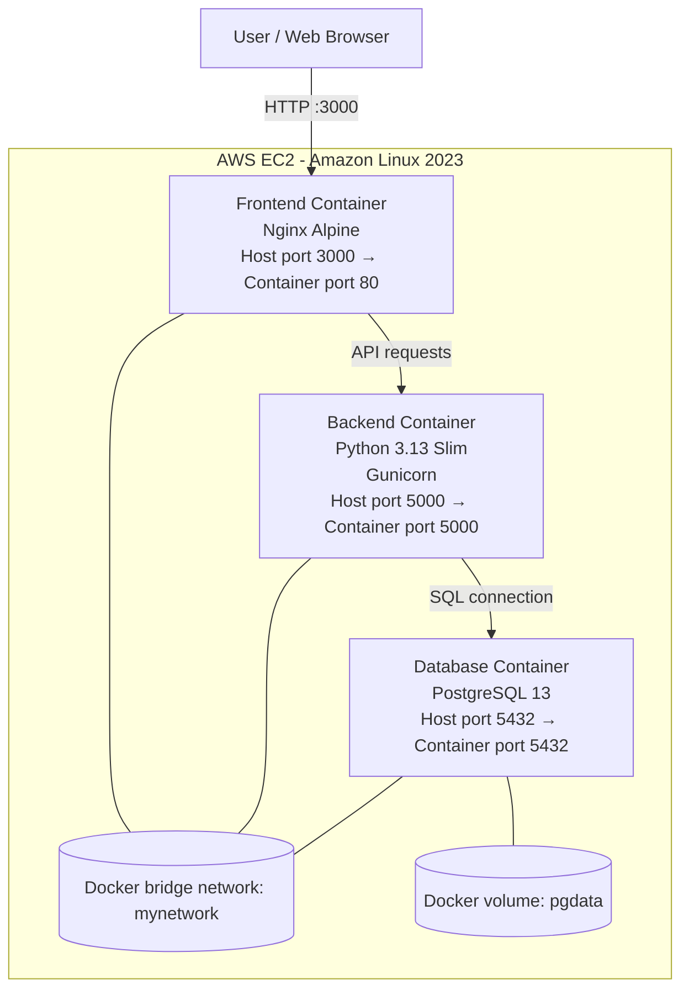

# Three Tier Application using Docker

A Dockerized three-tier student management application deployed on an AWS EC2 instance. The project separates the frontend, backend API, and PostgreSQL database into independent containers connected through a custom Docker bridge network.

## Project Overview

The **Space9 Student Management Dashboard** provides a web interface to manage student records. The frontend is served by Nginx, the backend is a Python application running with Gunicorn, and PostgreSQL stores the application data.

The application was accessed in a browser using:

```text
http://43.205.212.152:3000
```

> **Deployment note:** The address above is the public IPv4 address visible in the supplied screenshot. An EC2 public IP can change if the instance is stopped and started, unless an Elastic IP is associated.

## Architecture



### Three tiers

| Tier | Technology | Container | Port mapping |
|---|---|---|---|
| Presentation | Nginx Alpine | `frontend` | `3000:80` |
| Application | Python 3.13 Slim + Gunicorn | `mypython-container` | `5000:5000` |
| Data | PostgreSQL 13 | `my_postgres` | `5432:5432` |

All three containers were connected to the user-created Docker bridge network named `mynetwork`. PostgreSQL data was stored in the named Docker volume `pgdata`.

## Technology Stack

- **Cloud:** AWS EC2
- **Operating system:** Amazon Linux 2023
- **Containerization:** Docker
- **Frontend web server:** Nginx Alpine
- **Backend runtime:** Python 3.13 Slim with Gunicorn
- **Database:** PostgreSQL 13
- **Networking:** Docker user-defined bridge network
- **Persistent storage:** Docker named volume

## Application Features

The supplied application screenshot shows these student-management functions:

- Add a student
- Update a student
- View student records
- Refresh the student list
- Edit a student record
- Delete a student record

The student form displays first name, last name, and email. The records table displays ID, name, email, and available actions.

## Repository Structure

The repository listing in the supplied terminal screenshot showed:

```text
Three-Tier-Application/
├── backend/
│   ├── Dockerfile
│   ├── app.py
│   └── requirements.txt
├── database/
│   └── .env
├── frontend/
│   └── Dockerfile
├── docker-compose.yaml
├── cmd.md
└── compose-cmd.md
```

The screenshot also showed a hidden `backend/.env` file. Environment files can contain credentials; do not commit real secrets to a public repository. Use a safe example file such as `.env.example` if documenting required variables.

## Deployment on AWS EC2

The following sequence reflects the commands visible in the supplied screenshots. Run commands from the EC2 terminal unless otherwise stated.

### 1. Connect to the EC2 instance

From Windows Command Prompt or PowerShell, connect using your downloaded key pair:

```bash
ssh -i l3-mumbai.pem ec2-user@43.205.212.152
```

### 2. Clone the project repository

```bash
git clone https://github.com/VishalKonde01/Three-Tier-Application.git
cd Three-Tier-Application/
ls
```

### 3. Inspect the backend files and environment configuration

```bash
cd backend/
ls
ls -a
vim .env
```

Return to the project root before continuing:

```bash
cd ..
```

### 4. Create a Docker network

```bash
docker network create mynetwork
docker network inspect mynetwork
```

This creates a user-defined bridge network so the application containers can communicate by container name.

### 5. Create a persistent database volume

```bash
docker volume create pgdata
```

### 6. Start the PostgreSQL container

The screenshot shows the database environment file at `./database/.env` and PostgreSQL 13:

```bash
docker run -d \
  --name my_postgres \
  --network mynetwork \
  --env-file ./database/.env \
  -v pgdata:/var/lib/postgresql/data \
  -p 5432:5432 \
  --restart unless-stopped \
  postgres:13
```

Check the running containers:

```bash
docker ps
docker images
```

### 7. Create the database tables

Open a PostgreSQL shell inside the database container:

```bash
docker exec -it my_postgres psql -U admin -d mydatabase
```

The screenshot shows these table definitions:

```sql
CREATE TABLE IF NOT EXISTS students (
    student_id SERIAL PRIMARY KEY,
    first_name VARCHAR(50),
    last_name VARCHAR(50),
    birth_date DATE,
    email VARCHAR(100),
    enrolled_date DATE
);

CREATE TABLE IF NOT EXISTS items (
    id SERIAL PRIMARY KEY,
    name VARCHAR(255) NOT NULL,
    description TEXT
);
```

Verify the tables:

```sql
\dt
```

Exit the PostgreSQL shell:

```sql
exit
```

> The database username and database name above are the values shown in the terminal commands. Ensure they match the values configured in `database/.env`.

### 8. Build the backend Docker image

From the project root:

```bash
docker build -t mywebapp:vish-dev ./backend/
```

The screenshot shows the backend image built from `python:3.13-slim`, with the application working directory set to `/app`, dependencies installed from `requirements.txt`, and the application copied into the image.

### 9. Run the backend container

```bash
docker run -d \
  --name mypython-container \
  --network mynetwork \
  --env-file ./backend/.env \
  -p 5000:5000 \
  --restart unless-stopped \
  mywebapp:vish-dev
```

### 10. Build the frontend Docker image

```bash
docker build -t nginx-frontend ./frontend/
```

The frontend image uses `nginx:alpine` and copies the frontend files into Nginx's web root.

### 11. Run the frontend container

```bash
docker run -d \
  --name frontend \
  -p 3000:80 \
  nginx-frontend:latest
```

The frontend container publishes port `80` inside the container on port `3000` of the EC2 host.

### 12. Verify the containers

```bash
docker ps
docker images
```

The screenshot showed these containers running:

- `frontend`
- `mypython-container`
- `my_postgres`

## Testing the Application

1. Open the application in a browser:

   ```text
   http://<EC2_PUBLIC_IP>:3000
   ```

2. Add a student using the first name, last name, and email fields.
3. Refresh the student records list and confirm the record appears.
4. Use the Edit action to update a record.
5. Use the Delete action to remove a record.

The supplied screenshot shows the dashboard loaded in a browser and displaying student records with Edit and Delete actions.

## Useful Docker Commands

```bash
# List running containers
docker ps

# List all containers, including stopped ones
docker ps -a

# List local images
docker images

# Inspect the custom network
docker network inspect mynetwork

# View container logs
docker logs frontend
docker logs mypython-container
docker logs my_postgres

# Open a shell in the backend container
docker exec -it mypython-container /bin/sh

# Open PostgreSQL CLI
docker exec -it my_postgres psql -U admin -d mydatabase
```

## Important Deployment and Security Notes

- The screenshots show host ports `5000` and `5432` published. For a production deployment, avoid exposing the backend and database ports publicly unless there is a specific requirement. Keep PostgreSQL reachable only from the application tier or a trusted administrative network.
- Restrict EC2 Security Group inbound rules to the required sources. The browser-facing port in this deployment is `3000`.
- Use HTTPS with a domain name and TLS certificate for production traffic.
- Keep database credentials in environment configuration or a secrets manager. Never commit real `.env` files or passwords to Git.
- The named volume `pgdata` provides persistence for PostgreSQL data beyond the lifecycle of the database container.
- The screenshots show a `docker-compose.yaml` file in the repository, but the visible deployment steps use individual `docker network`, `docker volume`, `docker build`, and `docker run` commands. This README documents the commands that were visibly demonstrated and does not assume that Docker Compose was used to launch the application.

## Key Learnings

- Structuring an application into frontend, backend, and database tiers
- Building Docker images from separate Dockerfiles
- Running and managing multiple containers
- Creating a user-defined Docker bridge network
- Persisting database data with a named Docker volume
- Configuring containers with environment files
- Deploying a containerized application on AWS EC2
- Verifying a deployment through browser and Docker commands

## Future Improvements

- Use Docker Compose to define and manage the complete multi-container application.
- Keep PostgreSQL on an internal-only network and remove its public port mapping.
- Add HTTPS using a domain name and TLS certificate.
- Add health checks and container resource limits.
- Add automated build and deployment through a CI/CD pipeline.

---

**Project repository:** [Three-Tier-Application](https://github.com/VishalKonde01/Three-Tier-Application)


